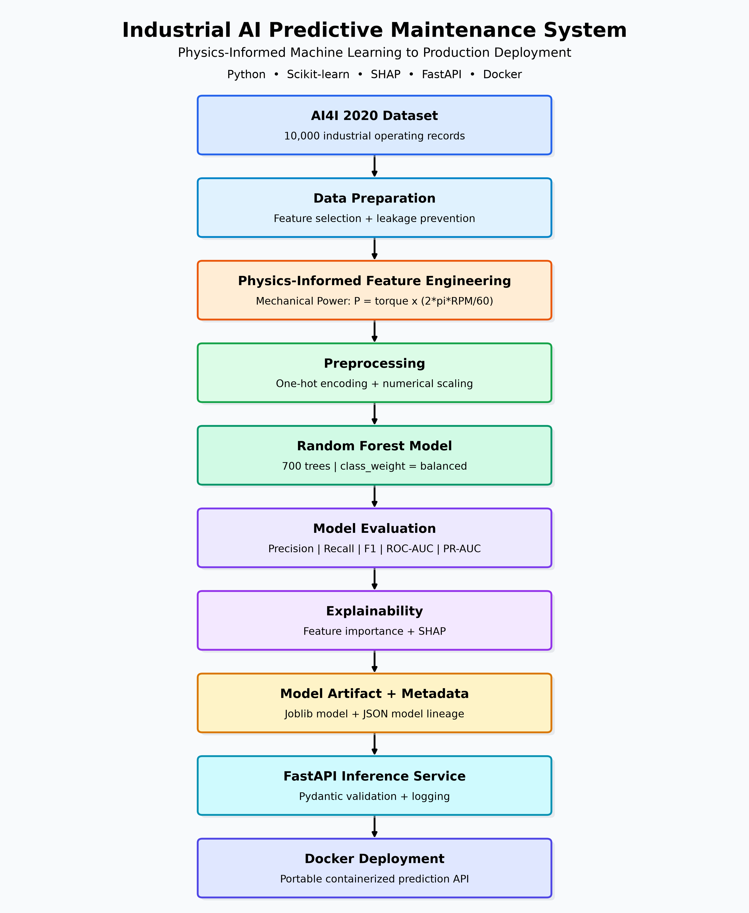
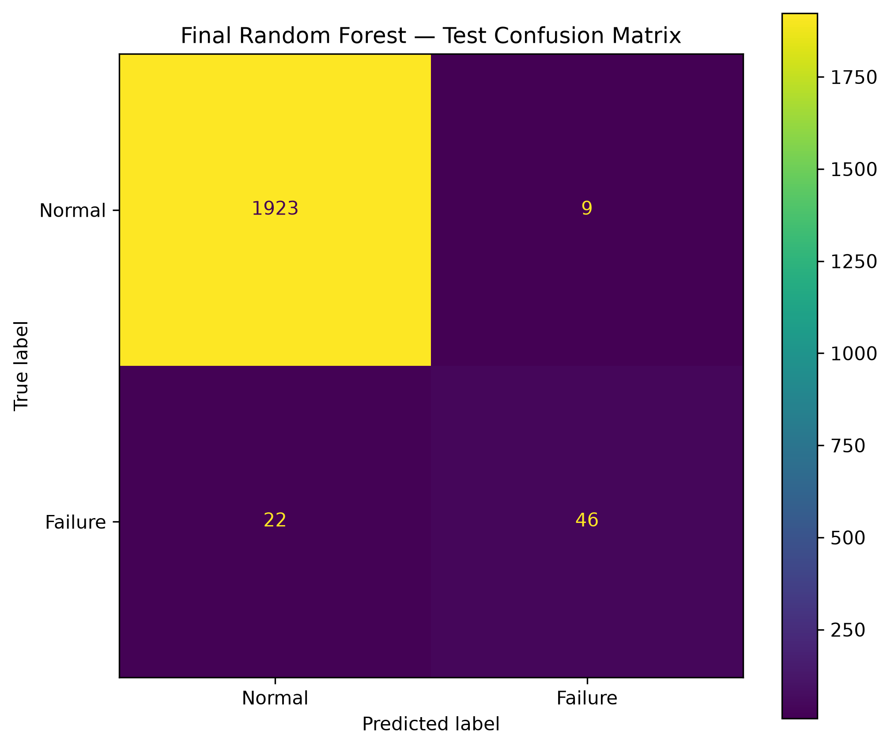
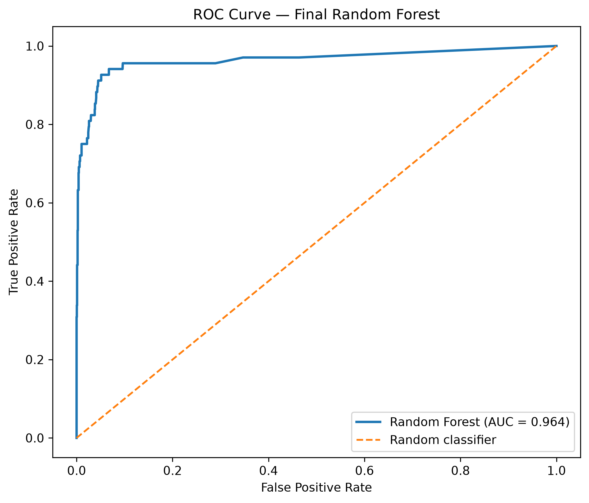
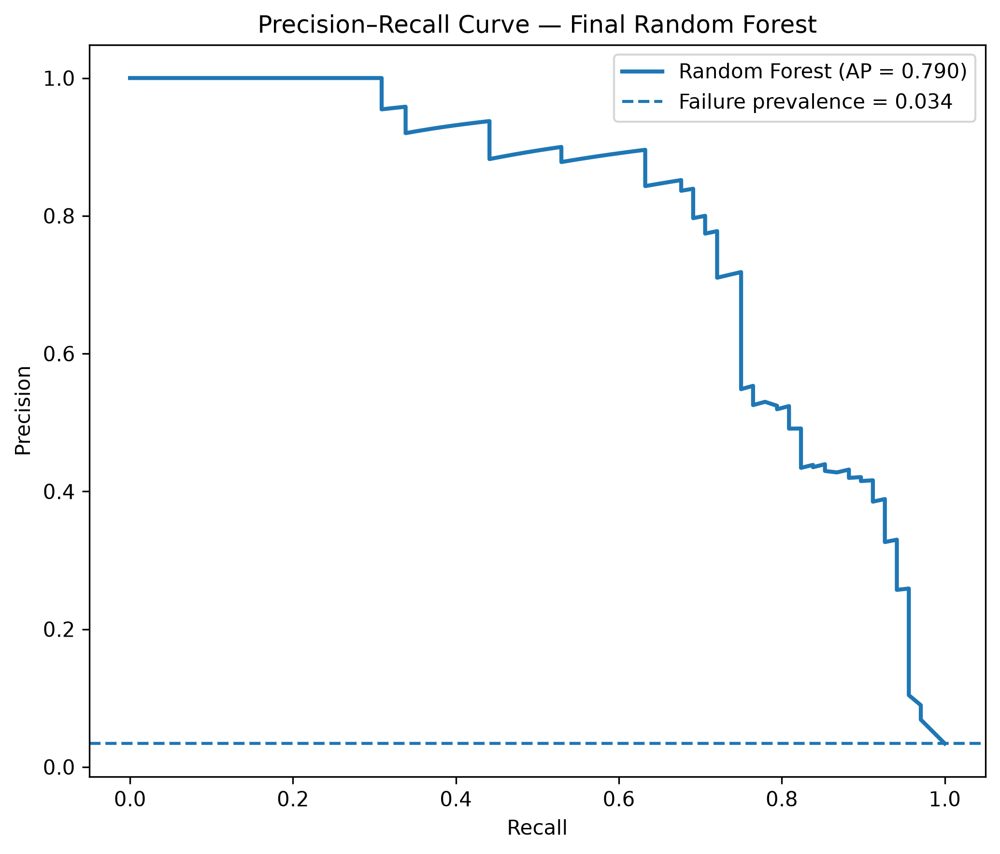
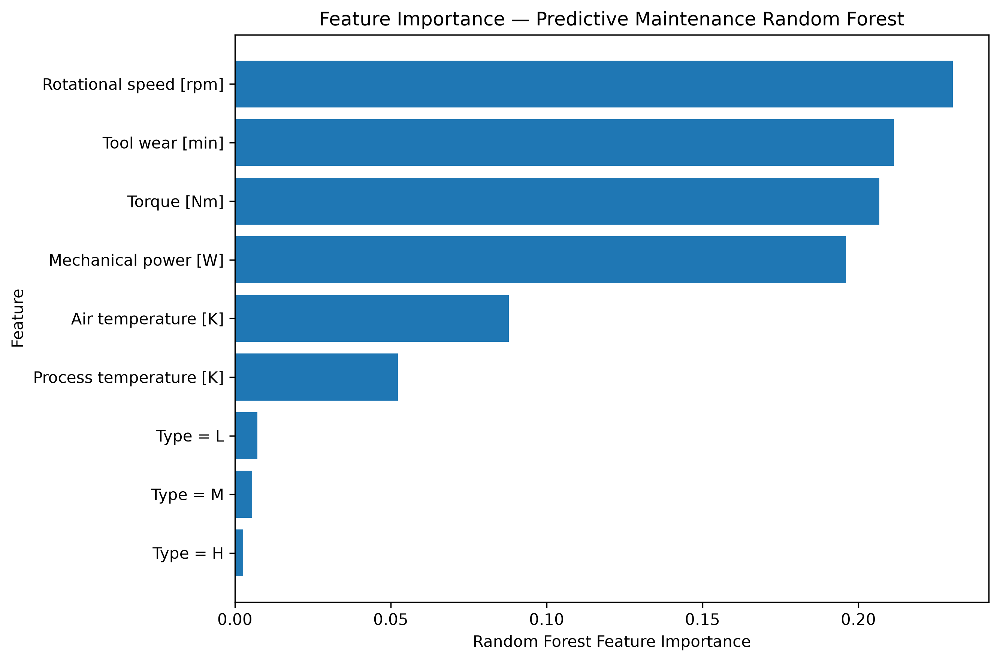
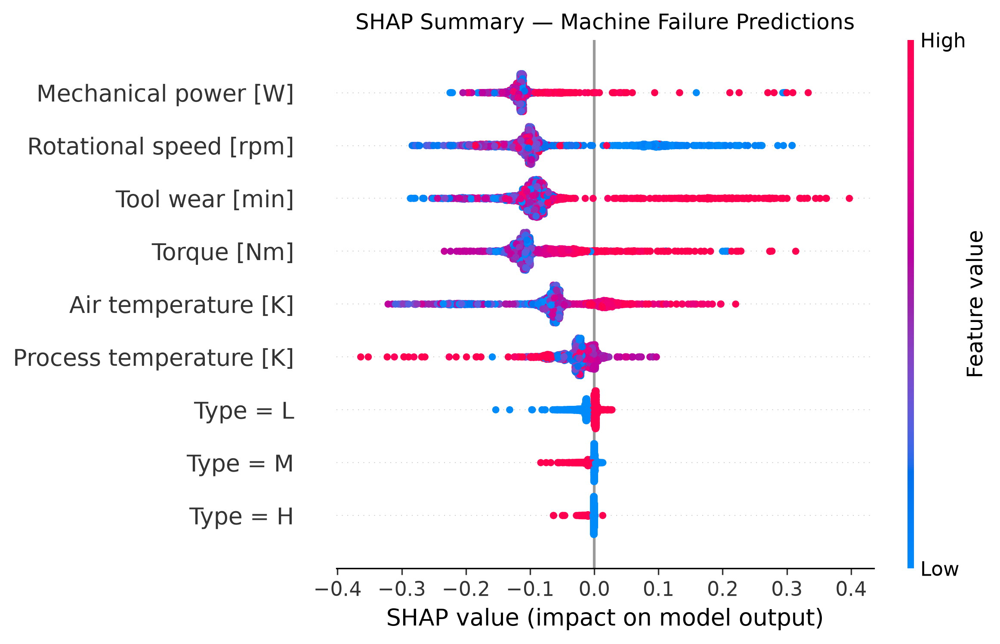
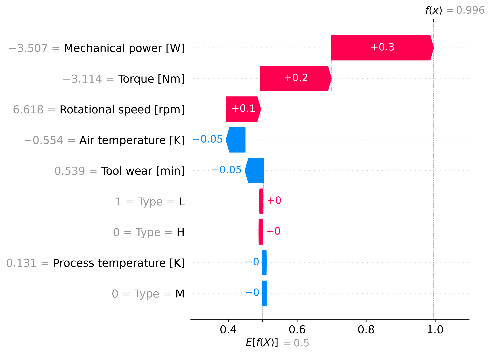

# Industrial AI Predictive Maintenance System

A production-oriented, physics-informed machine learning system for predicting industrial equipment failures using operational sensor data.

The project combines **machine learning, data science, engineering domain knowledge, explainable AI, software engineering, testing, API development, and containerization** into an end-to-end predictive maintenance workflow.



---

## Project Overview

Unexpected industrial equipment failure can lead to production downtime, maintenance costs, and operational disruption.

This project develops a machine learning system that estimates equipment failure risk from operating measurements such as:

- air temperature
- process temperature
- rotational speed
- torque
- tool wear
- product type

The system extends the raw measurements with a **physics-informed mechanical power feature**, trains and evaluates machine learning models under severe class imbalance, explains predictions using SHAP, and exposes the final model through a containerized FastAPI service.

---

## Engineering and Physics-Informed Feature Engineering

Instead of relying only on raw sensor variables, mechanical power is derived from rotational speed and torque.

Angular velocity is:

\[
\omega = \frac{2\pi N}{60}
\]

where:

- \(N\) = rotational speed in RPM
- \(\omega\) = angular velocity in rad/s

Mechanical power is:

\[
P = \tau\omega
\]

Therefore:

\[
P = \tau \frac{2\pi N}{60}
\]

where \(\tau\) is torque in Nm.

This feature captures the interaction between **rotational speed and torque** in a physically meaningful form.

For Logistic Regression, adding mechanical power improved PR-AUC from approximately **0.4205 to 0.4619**. For Random Forest, it improved PR-AUC from approximately **0.7339 to 0.8270** during cross-validation experiments.

---

## Dataset

The project uses the **AI4I 2020 Predictive Maintenance Dataset**.

| Property | Value |
|---|---:|
| Observations | 10,000 |
| Original columns | 14 |
| Failure observations | 339 |
| Failure prevalence | 3.39% |
| Primary target | Machine failure |

The low failure prevalence creates a significant **class imbalance** problem.

A classifier that predicts "no failure" for every machine would achieve approximately **96.61% accuracy while detecting zero failures**. Therefore, accuracy is not used as the primary model-selection metric.

### Leakage Prevention

The following failure-mode indicators were excluded from predictive model inputs:

- TWF — Tool Wear Failure
- HDF — Heat Dissipation Failure
- PWF — Power Failure
- OSF — Overstrain Failure
- RNF — Random Failure

These variables contain direct failure information and would introduce target leakage if used to predict `Machine failure`.

`UDI` and `Product ID` were also excluded because they are identifiers rather than meaningful predictive measurements.

---
## Machine Learning Experiments

The project evaluates multiple modeling strategies rather than relying on
a single algorithm. Model development progressed from simple baselines to
nonlinear ensemble methods.

### Techniques Evaluated

- Dummy Classifier — naive majority-class baseline
- Logistic Regression — interpretable linear baseline
- Class-Weighted Logistic Regression — imbalance-aware linear model
- Classification Threshold Optimization — precision/recall trade-off analysis
- Cost-Sensitive Classification — false-negative vs false-positive cost analysis
- Random Forest — nonlinear bagging ensemble
- XGBoost — gradient-boosted decision-tree ensemble
- Randomized Hyperparameter Search — model optimization
- Stratified 5-Fold Cross-Validation — robust model comparison
- SHAP — global and local model explainability

### Cross-Validation Results

All values below are based on 5-fold stratified cross-validation using
the training partition.

| Model | Precision | Recall | F1 | ROC-AUC | PR-AUC |
|---|---:|---:|---:|---:|---:|
| Standard Logistic Regression | 0.7694 | 0.2399 | 0.3646 | 0.9150 | 0.5008 |
| Balanced Logistic Regression | 0.1650 | 0.8231 | 0.2747 | 0.9196 | 0.4836 |
| Random Forest | 0.8043 | 0.7308 | 0.7639 | 0.9750 | 0.8270 |
| Tuned Random Forest | **0.8219** | 0.7345 | **0.7739** | 0.9755 | **0.8298** |
| XGBoost | 0.6240 | **0.8451** | 0.7168 | **0.9779** | 0.8087 |
| Tuned XGBoost | 0.7531 | 0.7933 | 0.7720 | 0.9761 | 0.8147 |

Because equipment failures account for only 3.39% of observations,
PR-AUC was used as the primary model-selection metric.

The tuned Random Forest achieved the highest cross-validation PR-AUC
(0.8298) and was therefore retained as the production model.

Tuned XGBoost produced higher recall (0.7933 versus 0.7345), demonstrating
a different operational trade-off: it detected a larger proportion of
failures but produced more false-positive predictions.

### Tuned XGBoost Configuration

```text
n_estimators     = 500
learning_rate    = 0.03
max_depth        = 6
min_child_weight = 1
subsample        = 0.9
colsample_bytree = 1.0
scale_pos_weight ≈ 28.52

The values above are **5-fold stratified cross-validation results on the training data**, rather than final test-set measurements.

PR-AUC was emphasized because failures represent only 3.39% of the dataset.

---

## Final Model

The selected model is a class-balanced Random Forest with:

```text
n_estimators      = 700
max_depth         = None
min_samples_split = 2
min_samples_leaf  = 1
max_features      = log2
class_weight      = balanced
random_state      = 42
```

### Held-Out Test Performance

| Metric | Result |
|---|---:|
| Precision | **0.8364** |
| Recall | **0.6765** |
| F1 Score | **0.7480** |
| ROC-AUC | **0.9639** |
| PR-AUC | **0.7903** |

The final confusion matrix was:

```text
TN = 1923    FP = 9
FN =   22    TP = 46
```

The model therefore correctly detected **46 of the 68 failure observations** in the held-out test partition while generating **9 false alarms**.







---

## Explainable AI

Model behavior was analyzed using both Random Forest feature importance and SHAP.

The strongest global predictors included:

1. Mechanical power
2. Rotational speed
3. Tool wear
4. Torque

Mechanical power ranked particularly strongly in SHAP analysis, supporting the usefulness of incorporating engineering knowledge into the feature-engineering process.





SHAP values describe how features influence the **model's predictions**. They should not be interpreted as evidence that a feature causes equipment failure.

---

## Local Prediction Explanation

One correctly detected failure had approximately:

```text
Type                 = L
Air temperature      = 298.9 K
Process temperature  = 310.2 K
Rotational speed     = 2737 RPM
Torque               = 8.8 Nm
Tool wear            = 142 min
Mechanical power     = 2522.24 W
Failure probability  = 99.57%
```

SHAP showed that the unusual combination of very high rotational speed, low torque, and low mechanical power strongly increased the model's failure prediction for this observation.

This illustrates why nonlinear models are useful: failure risk is associated with **operating regimes and interactions**, not simply whether one variable is high or low.



---

## Production ML Pipeline

The notebook analysis was converted into reusable Python components.

```text
Raw Dataset
    |
    v
Feature Engineering
    |
    v
Reproducible Training
    |
    v
Model Evaluation
    |
    v
Serialized Model
    |
    v
Model Metadata
    |
    v
Inference Layer
    |
    v
FastAPI
    |
    v
Docker
```

The training workflow reproduces the reported final test metrics from the raw dataset using a fixed random seed and frozen model configuration.

---

## REST API

The trained model is exposed using **FastAPI**.

### Health Check

```http
GET /health
```

Example response:

```json
{
  "status": "healthy"
}
```

### Failure Prediction

```http
POST /predict
```

Example request:

```json
{
  "type": "L",
  "air_temperature": 298.9,
  "process_temperature": 310.2,
  "rotational_speed": 2737,
  "torque": 8.8,
  "tool_wear": 142
}
```

Example response:

```json
{
  "failure_probability": 0.995714,
  "predicted_failure": 1
}
```

Pydantic validates incoming data before inference.

---

## Automated Testing

The project includes tests for:

- physics-based mechanical power calculation
- missing feature handling
- prediction output
- threshold validation
- API health endpoint
- API prediction endpoint
- invalid product type
- invalid rotational speed

Current test status:

```text
8 passed
```

Run the test suite with:

```bash
pytest
```

---

## Docker

Build the container:

```bash
docker build -t predictive-maintenance-api .
```

Run it:

```bash
docker run -p 8000:8000 predictive-maintenance-api
```

The API is then available locally on port `8000`.

FastAPI automatically provides interactive API documentation at `/docs`.

---

## Model Reproducibility and Lineage

The training pipeline generates:

```text
models/
├── predictive_maintenance_rf_reproduced.joblib
└── model_metadata.json
```

The metadata records:

- model name and version
- training timestamp
- dataset information
- training/test sample counts
- model features
- engineered features
- leakage exclusions
- physics equation
- hyperparameters
- classification threshold
- evaluation metrics

This provides lightweight model lineage without requiring additional infrastructure.

---

## Project Structure

```text
Predective_maintenance_AI/
|
├── api/
│   ├── __init__.py
│   └── main.py
|
├── data/
│   └── raw/
│       └── ai4i2020.csv
|
├── models/
│   ├── predictive_maintenance_rf.joblib
│   ├── predictive_maintenance_rf_reproduced.joblib
│   └── model_metadata.json
|
├── notebook/
│   └── 01_data_understanding.ipynb
|
├── reports/
│   └── figures/
|
├── src/
│   ├── features/
│   │   └── engineering.py
│   ├── models/
│   │   ├── predict.py
│   │   └── train.py
│   └── visualization/
│       └── architecture.py
|
├── tests/
│   ├── test_api.py
│   ├── test_engineering.py
│   └── test_predict.py
|
├── Dockerfile
├── requirements.txt
├── requirements-dev.txt
├── .dockerignore
├── .gitignore
└── README.md
```

---

## Technology Stack

**Machine Learning:** Python, Scikit-learn, Random Forest, Logistic Regression  
**Data Science:** Pandas, NumPy, Matplotlib  
**Explainable AI:** SHAP  
**Engineering:** Torque, rotational dynamics, mechanical power analysis  
**API:** FastAPI, Pydantic, Uvicorn  
**Testing:** Pytest  
**MLOps:** Model serialization, metadata, reproducible training  
**Deployment:** Docker  
**Development:** VS Code, Jupyter, Git

---

## Key Technical Lessons

This project demonstrates several practical machine-learning engineering principles:

- Accuracy alone is misleading for highly imbalanced failure prediction.
- Domain knowledge can produce useful features that generic preprocessing does not create automatically.
- Target leakage must be identified before model training.
- Cross-validation provides a stronger model-selection signal than a single validation result.
- Classification thresholds represent operational decisions rather than changes to the underlying model.
- Explainability describes model behavior, not causality.
- Notebook experimentation should eventually become reusable and testable production code.
- Reproducibility requires preserving model configuration, feature definitions, random seeds, and metadata.

---

## Future Improvements

Potential extensions include:

- probability calibration
- time-aware predictive maintenance datasets
- remaining-useful-life prediction
- streaming sensor ingestion
- model/data drift monitoring
- cloud deployment
- CI/CD automation
- model registry and experiment tracking
- multi-class failure-mode diagnosis

---

## Disclaimer

The AI4I dataset is a synthetic predictive-maintenance dataset. Results demonstrate machine-learning methodology and production engineering practices and should not be interpreted as validated performance on a real industrial production system.